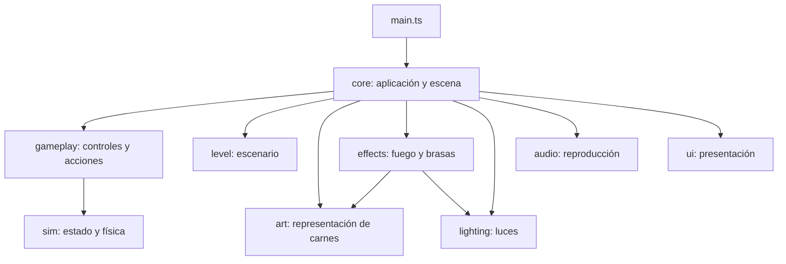

# Módulos y trabajo del equipo

Organización implementada el 29/10/2026 sobre el prototipo existente. Los responsables son sugeridos según los roles compartidos; el equipo puede ajustar la distribución.

## Ubicación y responsabilidades

| Carpeta | Responsabilidad | Referentes sugeridos | Punto de entrada |
| --- | --- | --- | --- |
| `src/core/` | Arranque, renderizador, composición y orden de actualización | Manuel; Alessandro en dirección técnica | `application.ts` |
| `src/sim/` | Combustión, brasas, transferencia de calor y cinco capas por carne | Luciano y Manuel; Gonzalo en reglas | `world.ts` |
| `src/gameplay/` | Acciones, herramientas, teclado, selección y movimiento | Luciano | `actions.ts`, `input.ts`, `player.ts` |
| `src/level/` | Patio, asador, parrilla, mesas, suministros y distribución | Emily y Gonzalo | `patio.ts`, `layout.ts` |
| `src/art/` | Modelos, geometrías, texturas y materiales | Valentino | `meat-visual.ts`, `brazier-model.ts`, `fuel-model.ts` |
| `src/lighting/` | Luz de patio, fuego, sombras y luces de muestras | Valentino; soporte de Manuel | `lighting.ts` |
| `src/effects/` | Llamas, resplandor visual, dispersión y caída de brasas | Valentino; soporte de programación | `brazier-effects.ts`, `grill-embers.ts` |
| `src/audio/` | Reproducción y mezcla de audio | Tiziana; soporte de Manuel | `audio.ts` |
| `src/ui/` | Menú, HUD, mensajes, ayuda y diagnóstico F3 | Martín y Emily | `hud.ts`, `template.ts`, `style.css` |

Apoyos: `src/assets/` conserva las texturas y su procedencia; `src/previews/` contiene muestras orbitales de materiales; `tests/` contiene las pruebas. `src/main.ts` sólo inicia la aplicación y carga el CSS.

Producción, dirección creativa y narrativa trabajan con documentación, planificación y criterios de aceptación. World Builder aporta al escenario. No se creó un sistema de NPCs ni un módulo de IA vacío; se incorporará cuando una mecánica lo requiera. Technical Artist cubre integración de modelos y texturas, materiales, efectos y rendimiento visual.

## Cómo se conectan



El diagrama muestra coordinación funcional. Las importaciones concretas también incluyen tipos y datos de distribución compartidos. La simulación no importa módulos visuales, audio, navegador ni Three.js.

1. `core/application.ts` crea una sola instancia de `SimulationWorld`, el reloj, la interfaz, el audio y los controles.
2. `gameplay/player.ts` selecciona un objeto y devuelve `{ kind, index?, meatId? }`. `gameplay/actions.ts` aplica la acción correspondiente al mundo; puede probarse sin cámara ni DOM.
3. El reloj conserva el paso fijo y el factor ×10. Sólo `core` avanza la partida mientras se juega y la pestaña está visible. Los efectos reciben también tiempo real para sus animaciones.
4. Arte y efectos leen el estado simulado para representar las carnes, el combustible y las brasas. No consumen masa ni recalculan calor.
5. La iluminación de fuego recibe sólo `lit` y `tinderBurning`. El audio recibe flujo de calor y estado de juego. La interfaz recibe el mundo y los datos de selección/herramienta.

No hace falta incorporar un bus de eventos, otro motor o dependencias nuevas para esta división. Cuando se agreguen sonidos puntuales, sus señales se conectarán desde las acciones o transiciones que ya existen.

## Contratos de trabajo

| Sistema | Entrada | Salida / operación pública |
| --- | --- | --- |
| Simulación | Segundos simulados y acciones | `tick`, `takeMeat`, `placeMeat`, `flipMeat`, `depositEmber`, etc.; estado del mundo |
| Jugabilidad | Objetivo semántico y herramienta | `interact`, `primaryAction`, `equip`, `flip`, `rotate`; mensajes mediante callback |
| Escenario | Escena y lista de objetos seleccionables | Mallas estáticas, límites y posiciones |
| Arte | Carne/combustible y escala visual | Grupos, mallas seleccionables y actualización de apariencia |
| Efectos | Estado del mundo y segundos reales acumulados | Actualización de llamas y brasas, sin mutar la simulación |
| Iluminación | Escena o grupo; estado simple del fuego | Luces y su actualización |
| Audio | Gesto de inicio, flujo de calor y pausa | `start`, `update`, `pause`, `dispose` |
| Interfaz | Mundo, herramienta y objetivo | `update`, `showMessage`, `toggleDebug`, `setPlaying`, `onPlay` |

El sonido actual sigue siendo un chisporroteo sintético provisional. La separación no incorpora grabaciones, música, humo o chispas nuevos.

## Dónde editar cada tarea

- Intensidad/color del sol, ambiente y fuego: `src/lighting/lighting.ts`, objeto `LIGHTING_SETTINGS`. Las luces de las muestras están en `createPreviewLighting` del mismo archivo.
- Volumen y filtro del chisporroteo: `src/audio/audio.ts`, objeto `AUDIO_SETTINGS`.
- Forma y animación de llamas: `src/effects/brazier-effects.ts` y `fuel-flames.ts`.
- Fragmentos y dispersión de brasas: `src/effects/ember-scatter.ts` y `grill-embers.ts`.
- Aspecto del brasero y combustible: `src/art/brazier-model.ts` y `fuel-model.ts`.
- Silueta y propiedades físicas de cortes: `src/sim/meatCatalog.ts`; aspecto de sus superficies: `src/art/*-visual.ts`. Un cambio de silueta debe coordinar ambos para conservar huella y selección.
- Coeficientes térmicos: `src/sim/parameters.ts`. No ajustar la cocción mediante luces, materiales o audio.
- Distribución del patio/asador: `src/level/patio.ts`, `layout.ts` y `asador.ts`. Coordinar geometría y límites de colisión al mover estructuras.
- Teclas: `src/gameplay/input.ts`; acciones: `actions.ts`; movimiento/alcance: `player.ts`.
- Textos del menú y estructura del HUD: `src/ui/template.ts`; estilos: `style.css`; actualización y F3: `hud.ts`.

## Cómo trabajar y comprobar cambios

Cada carpeta tiene un README breve. Trabajar desde la raíz del proyecto, aunque se edite un único módulo:

```sh
npm run dev
npm test
npm run typecheck
npm run build
```

La partida sigue en `/`; las muestras siguen en `/matambre-preview.html` y `/vacio-preview.html`. No cambiaron los controles.

Antes de integrar: comprobar el módulo propio y al menos una conexión que utilice. Para iluminación, revisar patio y muestras; para efectos, encender papel y verificar su extinción y caída de brasas; para audio, entrar y pausar; para jugabilidad, recoger/colocar/girar; para UI, menú, ayuda y F3. Evitar editar `core/application.ts` desde varias tareas simultáneas: Manuel puede coordinar los cambios de integración.

Mantener las funciones públicas cuando sea posible. Si se cambia un contrato, actualizar sus consumidores y pruebas en el mismo cambio. Cada módulo puede tener varios colaboradores; las carpetas no conceden exclusividad ni permisos técnicos.

## Migración desde la estructura anterior

| Antes | Ahora |
| --- | --- |
| `src/main.ts` con audio, interfaz, acciones y movimiento | `src/core/application.ts` conecta `audio/`, `ui/` y `gameplay/` |
| `src/game/scene.ts` | `src/core/scene.ts`, `src/level/`, `src/lighting/`, `src/art/meat-views.ts`, `src/effects/grill-embers.ts` |
| `src/game/brazier.ts` | `src/art/brazier-model.ts`, `fuel-model.ts`, `src/effects/brazier-effects.ts`, `fuel-flames.ts`, `src/lighting/lighting.ts` |
| `src/game/asador.ts` | `src/level/asador.ts` |
| `src/game/input.ts` | `src/gameplay/input.ts` |
| `src/game/ember-scatter.ts` | `src/effects/ember-scatter.ts` |
| `src/game/*-visual.ts`, `meat-surface-geometry.ts` | `src/art/` |
| `src/game/*-preview.ts`, `meat-preview-stage.ts` | `src/previews/` |
| `src/style.css` | `src/ui/style.css` |

Las referencias a rutas antiguas en informes históricos describen entregas anteriores; esta tabla indica su ubicación vigente. `src/sim/` y los recursos de `src/assets/` se conservan byte por byte. No se avanzó a heladera ni se modificó la calibración térmica pendiente.
